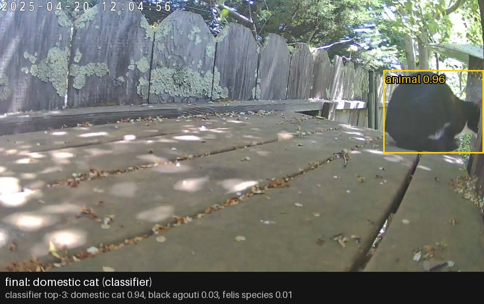
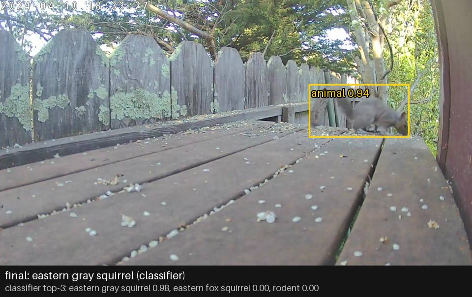
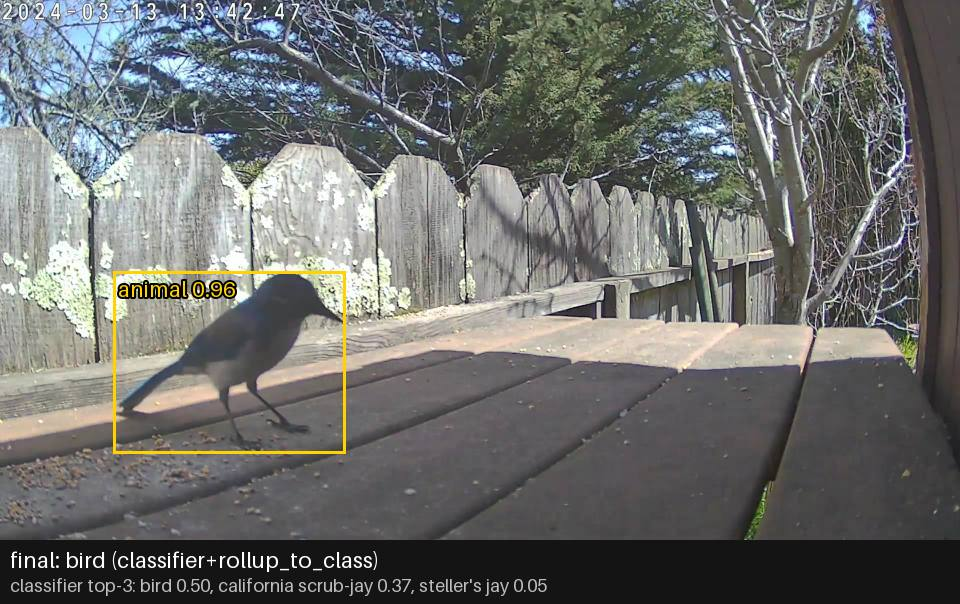
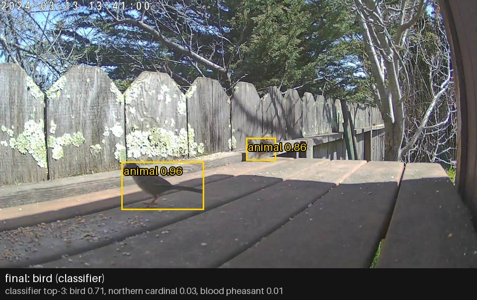
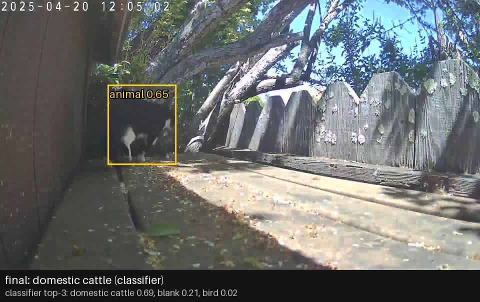
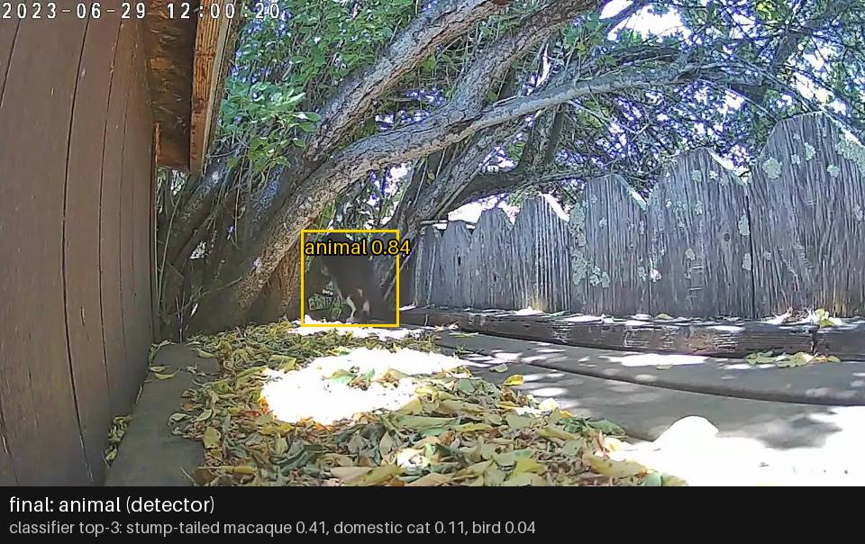
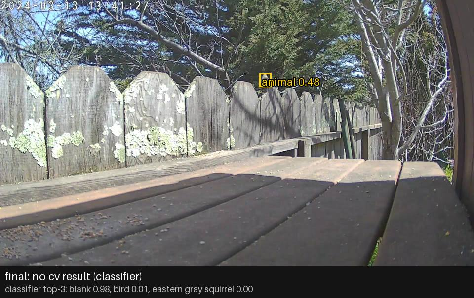

# SpeciesNet on the known_good_6 clips

_Last updated: 2026-10-08_

A first test of Google's [SpeciesNet](https://github.com/google/cameratrapai) as tiers 2 and 3 of the
detection pipeline (MegaDetector boxes, then a species classifier on each box), run on six clips
from our own cameras before committing the phase 2 design to it.

**Result:** the detector finds animals reliably, mammals in clear view get the right species, and
small birds come back as "bird". Single frames make confident mistakes, so labels must be decided
per visit, not per frame.

## Method

- **Model:** `speciesnet` 5.0.5 (PyPI), classifier `v4.0.3a` (Kaggle, 214 MB), MegaDetector v5a
  (281 MB). PyTorch 2.2.2 on CPU, Intel i7 MacBook Pro.
- **Input:** 244 frames pulled from a six-clip known-good recording set with ffmpeg: 3 fps for
  clips under 10 s, 1 fps for the rest.
- **Labels:** the classifier's 2,498 labels are in [speciesnet-labels-v4.0.3a.txt](speciesnet-labels-v4.0.3a.txt),
  copied unchanged from the model download (Apache-2.0). Each line is
  `id;class;order;family;genus;species;common name`; blank fields mark higher-level labels.
- **Location:** `--country USA --admin1_region CA`. SpeciesNet uses this to drop species that
  don't occur in California (for example blue jay, which it then rolls up to "bird").
- **Ground truth:** the clip names from the old 5-class model, plus a look at sample frames. The
  old `_detections.json` files only say "Animal", so they couldn't be used for species.
- All clips are daytime. Nothing here tests night, IR, skunks or rats.

```bash
python -m speciesnet.scripts.run_model --folders frames --predictions_json predictions.json \
  --country USA --admin1_region CA
```

## Results

| Clip | Frames | In the clip | SpeciesNet final label (frames) | Verdict |
|---|---|---|---|---|
| `48225456FF0A_…_cam0` | 17 | cat, close, in clear view | domestic cat 15, blank 2 | Excellent |
| `short_squirrel_jay_video` | 100 | squirrel, jay | eastern gray squirrel 70, *Sciurus* 11, rodent 9, *Sciuridae* 2, bird 5, blank 3 | Squirrel strong; jay mostly not labelled while the squirrel was in frame |
| `short_jay_video` | 30 | California scrub-jay | bird 25, animal 4, blank 1 | Found in 29/30. Top species guess was right (scrub-jay) but below the confidence bar |
| `short_bird_video` | 42 | small brown birds that look like sparrows | bird 22, blank 11, animal 5, no cv result 4 | "Bird" only; species guesses weak |
| `short_cat_video` (720p) | 31 | cat for part of the clip | blank 22, animal 5, domestic cat 3, mammal 1 | Weak |
| `48225422D161_…_cam0` | 24 | cat, partly hidden behind the tree | blank 11, no cv result 8, animal 2, **domestic cattle 2**, mammal 1 | Detector found it; classifier named the wrong species |

Speed: about 4.3 s per frame on this CPU (244 frames in about 17 minutes).

## Edge cases

Yellow boxes are MegaDetector detections at confidence 0.2 or above. The bar under each frame gives
SpeciesNet's final label, where it came from, and the classifier's raw top three.

### Clear cat: right answer


### Squirrel: right to the species


Eastern gray squirrel is introduced in California, so this is plausible. Fox squirrel is the
runner-up we'd want to rule out, at 0.00 here.

### Scrub-jay: right guess, rolled up to "bird"


The classifier's best species is right, but at 0.37 it isn't confident enough, so the ensemble
rolls up to the class. This is the behaviour we want: a correct coarse label beats a confident
wrong one.

### Sparrows: "bird"


Both birds are detected (0.96 and 0.86), and the label is "bird". No species guess is above 0.03.

### Hidden black-and-white cat: "domestic cattle"


The only confident wrong species in the run. The crop shows a patch of black-and-white fur, which
looks like a Holstein. Two fixes, both in the phase 2 design: vote across the visit's frames, and a
per-site allowlist that turns any species not plausible for a backyard into its class
(here "mammal").

### Macaque guess: refused, labelled "animal"


The classifier's top guess was stump-tailed macaque (0.41) and domestic cat was second (0.11).
SpeciesNet declined to name a species and kept the detector's "animal". The ensemble already
protects against some of these mistakes; the allowlist would cover the rest.

### Detector and classifier disagree: "no cv result"


A small bird on the far fence. The detector boxes it (0.48), and the whole-image classifier says
blank (0.98). SpeciesNet reports the conflict as "no cv result" rather than choosing. All 12
"no cv result" frames in the run look like this. Treat it as "unknown, maybe an animal", not as
blank.

## What this decides

1. **SpeciesNet is the tier 2 and 3 baseline.** It's strong for finding animals and for mammals;
   for birds it says "bird".
2. **Labels are decided per visit**, by a score-weighted vote across the visit's frames, falling
   back to the shared taxonomy level when frames disagree.
3. **A per-site allowlist** sits on top of the California filter.
4. **Tier 1 motion detection is required.** At seconds per frame, running every frame from six
   cameras through the model isn't possible on any hardware we have.
5. **Follow-up project:** a bird classifier trained only on the birds our cameras actually see,
   using crops from SpeciesNet's boxes. Cats need nothing further: "domestic cat" is enough.

## Addendum: sorting "bird" into bird groups

For frames whose final label was plain "bird", the classifier's top-5 scores were summed by bird
group (crows, jays, songbirds, doves/pigeons, hawks, owls; prefixes in the
[phase 2 design](phase2-design.md#data-model)), assigning the group when its total was 0.3 or more.

| Clip | "bird" frames | Sorted | Unsorted | Sorted into a wrong group |
|---|---|---|---|---|
| `short_jay_video` | 25 | jays 9 | 16 | 0 |
| `short_squirrel_jay_video` | 5 | jays 4 | 1 | 0 |
| `short_bird_video` | 22 | 0 | 22 | 0 |

Jays sort well enough for a per-visit vote. The sparrow-like birds don't: no group gets enough of
the score.

Also found: SpeciesNet classifies only the **top** box in each frame (`speciesnet/classifier.py`,
`always_crop` mode). In the two-bird frame above, only one bird was actually classified.

## Not yet tested

- Night and IR footage, skunks, rats, raccoons (phase 2 questions 3 and 5).
- Speed on the Mac Studio M2 (MPS).
- Per-frame ground truth: the "blank" counts weren't checked frame by frame, so some may be misses.
